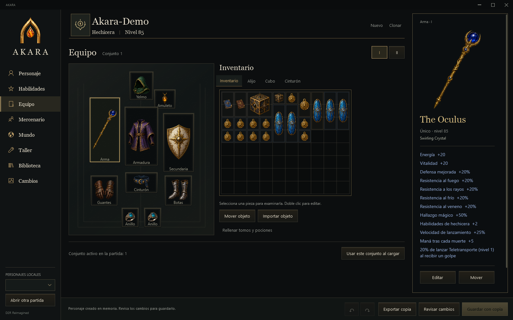

<p></p>

# AKARA

A native Windows character editor for Diablo II: Resurrected. AKARA uses WPF and .NET 10: its Spanish interface opens as a desktop window and calls the character-editing Core directly.

Version **0.3.0**. Developed against **D2R Reimagined 3.1**, using data from your own installation. The portable package includes its runtime; no browser, WebView, Node.js or local web server is required.



[Inicio rápido en español](#inicio-rápido-en-español) · [Build from source](#build-from-source) · [CLI](docs/cli.md) · [Verification](#verification) · [License](LICENSE)

## What it does

- Opens offline `.d2s` characters. Creates version 105 characters for all eight classes, or clones an existing character into a new draft.
- Edits level, experience, base attributes, gold, and skills, with native budgets, requirements, prerequisites, and encoding checks. Base resources update from native progression and attribute scaling.
- Offers nine Reimagined presets: one per class, including a Frozen Orb/lightning Sorceress, plus the original Frozen Orb/Tal Rasha preset. Guides explain attacks, buffs, weapon switching, and immunities.
- Arranges inventory, personal stash, cube, belt, both weapon sets, and mercenary equipment. Reimagined supports nine equipped mercenary pieces; a two-handed weapon reserves the off hand without adding a duplicate item. Inventory actions have controls that do not require dragging.
- Edits quests and waypoints by difficulty, progression, and rewards through **Mundo**.
- Builds items in **Taller** using native bases, qualities, affixes, property values and layers, sockets, ethereal flags, and personalization. Imports and exports individual item blueprints.
- Saves reusable loadouts in a local library, with JSON import/export and optional character progression. Applying a loadout keeps previous equipment in the personal stash by default. At the same level, it preserves the destination character's experience; changing level uses that level's native starting XP. Clone a character to retain its exact XP.
- Prepares a validated preview and readable diff before writing. Undo/redo changes the draft; backup restoration recovers an earlier saved file.
- Exports a new copy without overwriting a destination. Replacement and restoration require Diablo II to be closed and use verified backups, source-hash checks, and atomic replacement.
- Provides a standalone JSON CLI using the same Core: persistent plans, creation, batches, item design, blueprints, loadouts, backups, and restore.

Custom items use existing native bases and properties. Adding new game definitions or artwork requires a separate mod-data workflow. Online characters and shared-stash files are outside the editor's scope.

## Inicio rápido en español

1. Extrae el paquete para Windows y abre **Akara.exe**. Se abre la ventana nativa de escritorio; el paquete portátil no necesita Node.js, PowerShell ni .NET instalados.
2. Elige una partida o pulsa **Abrir otra partida**. Selecciona el perfil que corresponde al personaje. Si AKARA no detecta el mod, indica su carpeta de tablas.
3. Para empezar desde cero, pulsa **Nuevo personaje** y elige clase, nombre y, si quieres, una plantilla. **Clonar personaje** prepara una copia con otro nombre. Todavía no se escribe ningún archivo.
4. Ajusta **Personaje**, **Habilidades**, **Equipo**, **Mercenario**, **Mundo** o **Taller**. En el equipo puedes cambiar entre los conjuntos I y II. La biblioteca permite preparar una plantilla o recuperar una configuración propia.
5. Pulsa **Revisar cambios**. Lee las diferencias y resuelve los errores. **Deshacer** y **Rehacer** actúan sobre el borrador.
6. Cierra Diablo II y pulsa **Guardar con copia**. Para un personaje nuevo, elige un archivo cuyo nombre coincida con el personaje; la creación nunca sobrescribe otro existente.
7. **Exportar copia** guarda otro archivo sin sobrescribir el destino. Puedes exportar fuera de **Saved Games** con el juego abierto. Crear o exportar dentro de **Saved Games** exige cerrar Diablo II. Si cambias el nombre, exporta con el nuevo nombre.
8. Consulta **Copias de seguridad** para restaurar una versión anterior. Cierra la ventana al terminar.

AKARA trabaja en tu equipo, sin cuenta ni envío de partidas a un servicio externo. Las tablas del juego y del mod deben estar disponibles en tu instalación; no se incluyen. La interfaz muestra atributos y recursos **base**: el juego calcula las bonificaciones del equipo. Si la partida cambia mientras editas, vuelve a abrirla y prepara de nuevo los cambios.

Consulta también [LEEME.txt](LEEME.txt).

## Compatibility

| Area | Current status |
| --- | --- |
| D2R Reimagined | Version 3.1 with a matching local TXT profile. Mod values can differ from vanilla Diablo II. |
| Existing saves | Versions **97–105** are accepted only when the original and candidate pass exact read/write roundtrip checks. No format conversion is performed. |
| New characters | Version **105**, all eight classes, constructed from profile data without distributing save templates. |
| Verification | Core/CLI checks cover version 105 fixtures, creation, native presets, encoding, and guarded writes. This does not establish in-game testing of all eight classes. Versions 97–104 have not each been verified with fixtures. |
| Item generation | Unsupported properties are rejected rather than omitted. Some Reimagined entries reference properties absent from its local `properties.txt`; those entries remain unavailable. |
| Other profiles | Matching local TXT directories can be registered. Per-file roundtrip checks remain mandatory; registration alone does not establish full compatibility. |
| Online / shared stash | Not edited. |

A stable binary roundtrip is an editing requirement, not proof that every possible item or build behaves correctly in the game.

## Local operation and backups

The native desktop application calls Core in-process. It has no HTTP host, browser or WebView dependency, telemetry, or cloud account requirement. The CLI calls the same Core separately.

Opening reads a character without writing it. Previews replay the draft from the original snapshot. Before replacement, AKARA checks the current file hash, creates and verifies a backup, rechecks the source and closed-game state, then replaces the file through a flushed temporary file in the same directory. Restore follows the same guarded path and backs up the displaced version.

Local settings, backups, exports, and loadouts normally live under `%LOCALAPPDATA%\AKARA`. Use `--data-dir DIRECTORY` to isolate another instance or a test run. Plans, blueprints, loadouts, logs, and screenshots may contain private character data or paths; keep them outside public commits.

AKARA does not include or download game binaries, installed tables, mod packages, or character saves.

## Build from source

Requirements: Windows x64, **.NET 10 SDK** and **PowerShell 7**. The native build has no npm step. Restoring build dependencies normally needs network access; packaged applications include the runtime.

From the repository root:

```powershell
$dotnetPath = (Get-Command dotnet).Source
./scripts/Publish.ps1 -DotnetPath $dotnetPath -OutputDirectory (Join-Path $PWD 'artifacts/AKARA-Desktop')
```

The script publishes the self-contained WPF GUI and CLI with documentation and dependency notices, then checks actual native rendering and behavior. Generated binaries and local game data do not belong in the source repository.

### Development

Run the native application with separate local state:

```powershell
$devData = Join-Path ([IO.Path]::GetTempPath()) 'akara-development'
dotnet run --project src/Akara.Desktop/Akara.Desktop.csproj -- --data-dir $devData
```

The old `ForjaHoradrica.Server` / `ForjaHoradrica.Web` client remains for historical reference. It is not shipped in the native package or built by the default native CI job. Core retains the earlier `ForjaHoradrica` technical namespace for compatibility.

### CLI

```powershell
akara-cli help
akara-cli doctor
akara-cli schema commands
```

Use `plan`, review its diff, then `validate` and `apply`. Changed source files or profiles invalidate a persistent plan; reopen and replan. See [CLI reference](docs/cli.md) and [automation examples](examples/automation).

## Verification

Public CI builds native WPF, Core, CLI and the integration runner. Data-dependent tests need your own local tables and private save copies; these are not distributed. Missing inputs are reported explicitly and are not counted as passing tests.

```powershell
dotnet build tests/ForjaHoradrica.Tests.csproj -c Release
dotnet build src/Akara.Cli/Akara.Cli.csproj -c Release
```

For integration runs, set `AKARA_TEST_EXCEL` to your installed profile and `AKARA_TEST_FIXTURES` to a private directory containing the required version 105 copies. The runner operates on temporary copies. See [test requirements](tests/README.md).

Native packaged checks render the real WPF control tree offscreen and exercise its ViewModels. They do not send mouse or keyboard input to the desktop:

```powershell
./scripts/Test-Native.ps1 -Executable ./artifacts/AKARA-Desktop/Akara.exe
./scripts/Test-Native.ps1 -Executable ./artifacts/AKARA-Desktop/Akara.exe -SavePath D:\PrivateFixtures\sorceress.d2s -ExcelPath D:\Games\D2R\data\global\excel
```

The test validates `PresentationFramework` metadata and PNG dimensions at desktop window sizes, then runs native behavior checks. Private-file flows use temporary copies and isolated state. Structural checks complement visual inspection; neither establishes in-game testing of every class. The retained [browser suite](tests/browser/README.md) verifies the historical 0.2 client, not the native UI.

## Project structure

| Path | Purpose |
| --- | --- |
| `src/Akara.Core` | Shared transformations, native profiles/items, validation, plans, backups, and persistence. |
| `src/Akara.Desktop` | Native WPF application, views, styles and ViewModels. |
| `src/Akara.Cli` | JSON commands and automation over Core. |
| `src/ForjaHoradrica.Server` | Legacy 0.2 loopback API, not included in the native package. |
| `src/ForjaHoradrica.Web` | Legacy 0.2 browser client, retained for reference. |
| `tests` | Core integration runner and legacy browser checks using private inputs. |
| `scripts` | Native packaging, offscreen rendering/behavior, and CLI checks. |
| `docs` | [Architecture](docs/ARCHITECTURE.md), [API](docs/api-v0.2.md), and [CLI](docs/cli.md). |

## Contributing

Include expected and actual behavior, save-format version, profile/mod version, and reproduction steps in an issue. Keep saves, installed tables, backups, private screenshots, tokens, personal paths, and generated plans out of public reports and commits. Encoding changes need a relevant roundtrip or behavior check with private inputs. Do not describe serialization checks as in-game verification.

## License and credits

AKARA is released under the [MIT License](LICENSE), copyright 2026 Arakiss. Dependencies retain their own licenses; notices are in [licenses](licenses).

The original mark, inventory illustrations and hand-authored class emblems are documented in [art provenance and review](design/native-0.3/PROVENANCE.md). Portrait candidates rejected during review are excluded from the app.

Save parsing and serialization use [D2SSharp](https://github.com/ResurrectedTrader/D2SSharp) 0.0.22 by ResurrectedTrader. Reimagined is a separate project: [D2R Reimagined](https://www.d2r-reimagined.com/). Diablo II and its game assets belong to their respective owners. AKARA is an independent community tool.
